# Making NAPLPS pages: a guide

This guide takes you from an empty file to a finished, animated NAPLPS page. Every example in it is a real page in [`examples/examples.py`](examples/examples.py), built with the 130-line helper [`examples/naplps_page.py`](examples/naplps_page.py), and every picture is that page drawn by this repository's renderer. [`reference.md`](reference.md) is the companion: it lists every byte, command and limit, and says where this renderer departs from the standard.

Contents: [1. What a page is](#1-what-a-page-is) · [2. Setting up](#2-setting-up) · [3. Hello](#3-hello) · [4. Coordinates](#4-coordinates) · [5. Shapes](#5-shapes) · [6. Colour](#6-colour) · [7. Lines and fills](#7-lines-and-fills) · [8. Text](#8-text) · [9. Mosaics](#9-mosaics) · [10. Macros](#10-macros) · [11. Your own characters](#11-your-own-characters) · [12. Scribbles](#12-scribbles) · [13. Time](#13-time) · [14. A whole page](#14-a-whole-page) · [15. Checking a page](#15-checking-a-page) · [16. What goes wrong](#16-what-goes-wrong)

## 1. What a page is

NAPLPS (ANSI X3.110-1983, CSA T500-1983) is the videotex format of Telidon and Prodigy. A page is a stream of bytes that a terminal acts on in order, as they arrive. There is no header, no length and no end marker: a page is whatever was sent.

Each byte is one of three things:

| Bytes | What they are |
|---|---|
| `00`-`1F` | Controls (C0): carriage return, clear screen, and the shifts that choose what the other bytes mean. |
| `20`-`7F` | Whatever the **current set** says: text characters, drawing commands, mosaic blocks, macro names. |
| `1B` then more | Escape sequences: more controls (C1), and choosing which sets are available. |

Two sets do nearly all the work:

- the **primary set** is ASCII. `48 65 6C 6C 6F` draws `Hello` at the text cursor;
- the **PDI set** (picture description instructions) draws. In it, `20`-`3F` are **opcodes** (line, rectangle, select colour, ...) and `40`-`7F` are their **operands** (coordinates, colours, flags), six bits of data in each byte.

`0E` (SO, shift out) switches to the PDI set, and `0F` (SI, shift in) switches back to text. A page is mostly: SO, draw; SI, write; SO, draw.

A PDI has no length either. It is an opcode followed by as many operand bytes as were sent, and it runs when the next byte that is not an operand arrives. That is why one LINE opcode can draw a polyline of any number of points.

This is the 7-bit form, which every example here uses and which works on any channel. The 8-bit form (drawing commands at `A0`-`FF`, no SO and SI) is in the [reference](reference.md#the-8-bit-form).

## 2. Setting up

You need this repository built, Python 3, and a font.

```
cargo build --release -p naplps-render
```

The renderer contains no font. The examples use the stroke font recovered from the period terminal program PP3, in `~/devel/teletext-reference/NAPLPS/fonts-extracted/data/microstar.strokes`. Without `--font`, text positions advance but no glyphs are drawn.

To build one page and look at it:

```
python3 docs/examples/examples.py tmp/pages
target/release/naplps-render --font ~/devel/teletext-reference/NAPLPS/fonts-extracted/data/microstar.strokes tmp/pages/01-hello.nap tmp/hello.ppm
ffmpeg -loglevel error -y -i tmp/hello.ppm tmp/hello.png
```

`naplps-render` writes a PPM picture, 640 by 480 unless you pass `--width` and `--height`. `docs/examples/build.sh` does all of this for every example and writes `docs/images/`.

The helper is not a framework. Each of its functions returns `bytes`, and a page is those bytes added together, so you can always see and count what you are sending:

```python
from naplps_page import *

page = SO + reset_all() + select(7) + text_at(0.35, 0.4, "Hello, NAPLPS")
open("hello.nap", "wb").write(page)
```

## 3. Hello

That page is 25 bytes:

```
0E             SO: the PDI set; opcodes and operands follow
20 7F 7F       RESET, both operand bytes all ones: everything to its default, screen cleared
3E 5C          SELECT COLOR, entry 7 of the colour map (white)
24 49 5C 56    POINT SET (absolute): move the drawing point to (0.35, 0.4)
0F             SI: the primary set; text follows
48 65 6C ...   "Hello, NAPLPS"
0E             SO: back to the PDI set
```

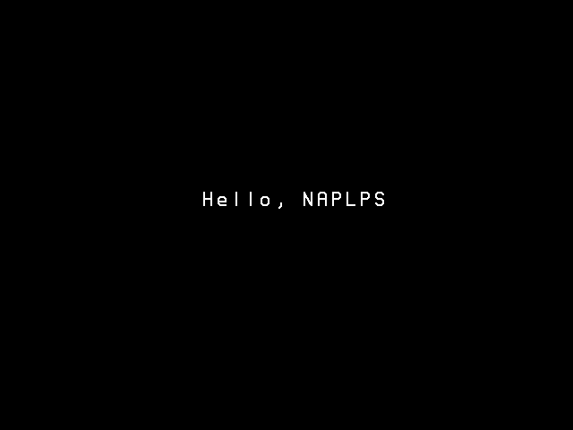

Three habits are worth forming here.

**Start every page with RESET.** A terminal keeps its state between pages: colours, text size, macros, even the meaning of operand bytes. `20 7F 7F` clears all of it and blanks the screen, so your page looks the same whatever came before. (`reset_all()` in the helper.)

**Position text with a drawing command.** The text cursor follows the drawing point, so POINT SET puts the cursor where the next character's lower left corner will be.

**Leave the page in the PDI set**, or at least in a known state, if more pages follow.

## 4. Coordinates

The screen is a unit square. x runs from 0 at the left to 1 at the right; y runs from 0 at the bottom **upward**. A 4:3 display shows the part of the square from y = 0 up to y = 25/32 (0.78125). Anything drawn above that is off the top of the screen.

```
(0, 0.78) ---------------- (1, 0.78)
    |                          |
    |      the visible page    |
    |                          |
(0, 0)   ----------------   (1, 0)
```

Coordinates are fractions, not pixels, so a page drawn for a 256-line terminal in 1983 renders sharply at any size today.

A coordinate pair is a **multi-value operand**: three bytes by default, carrying nine bits of x and nine of y, each a sign bit and eight fraction bits. The finest step is therefore 1/256 of the screen, and a value is a multiple of 1/256 from -1 to just under 1. The bits are interleaved, three of x then three of y in each byte, most significant first:

```
x = 0.35 -> 0.35 x 256 = 90  -> 0 01011010  -> 001 011 010
y = 0.40 -> 0.40 x 256 = 102 -> 0 01100110  -> 001 100 110

byte 1:  1  001 001  = 49
byte 2:  1  011 100  = 5C
byte 3:  1  010 110  = 56
```

The leading 1 is bit 7, which marks an operand byte. Negative values are two's complement and appear in relative moves: `xy(-0.15, 0.28)`.

`1.0` itself cannot be written in this form: the largest value is 255/256. Use 0.999 for "the right edge", as the examples do.

The last operand of a command may be cut short; its missing bytes count as zero. `xy(0.5, 0.25, length=1)` is one byte and exact, so a rectangle half the screen wide and a quarter high needs one size byte, not three. You can also change the length for the whole page with DOMAIN ([reference](reference.md#domain-21)) when you need finer steps than 1/256.

## 5. Shapes

There are five geometric primitives: point, line, arc, rectangle and polygon. Each has **four opcodes**. For lines, arcs, rectangles and polygons the pattern is the same:

| | Starts at the drawing point | "SET": its first operand is the start |
|---|---|---|
| line: **absolute** operands; shapes: **outlined** | first opcode | third opcode |
| line: **relative** operands; shapes: **filled** | second opcode | fourth opcode |

Every shape leaves the **drawing point** somewhere defined, and the next shape can start from it.

```python
page = SO + reset_all()
# A filled rectangle: lower left corner, then width and height.
page += select(BLUE) + pdi(SET_RECT_FILLED, xy(0.05, 0.45), xy(0.25, 0.25))
# A line from point to point, then on to a third point.
page += select(YELLOW) + pdi(SET_LINE_ABS, xy(0.38, 0.45), xy(0.50, 0.70), xy(0.62, 0.45))
# A filled circle: a point on it, then the step to the opposite point.
page += select(RED) + pdi(SET_ARC_FILLED, xy(0.70, 0.575), xy(0.25, 0))
# A filled polygon: first vertex, then the step to each following vertex.
page += select(GREEN) + pdi(SET_POLY_FILLED, xy(0.05, 0.08), xy(0.30, 0), xy(-0.15, 0.28))
# An arc through three points, outlined: start, step to a middle point, step to the end.
page += select(CYAN) + pdi(SET_ARC_OUTLINED, xy(0.40, 0.10), xy(0.11, 0.20), xy(0.11, -0.20))
# An outlined rectangle.
page += select(WHITE) + pdi(SET_RECT_OUTLINED, xy(0.70, 0.08), xy(0.25, 0.28))
```

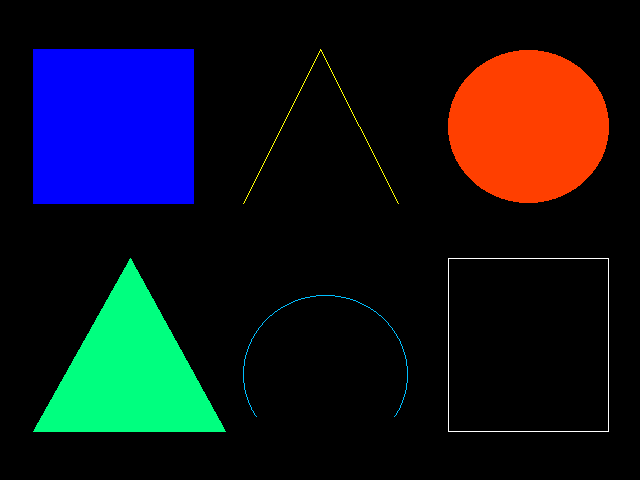

Things to know about each:

- **Rectangle**: a corner, then a width and height, which may be negative. Afterwards the drawing point has moved across by the width, so repeated operands draw a row of rectangles: a bar chart is one opcode.
- **Line**: `SET_LINE_ABS` takes points; `SET_LINE_REL` takes steps. More operands continue the line.
- **Polygon**: always **steps** between vertices, never absolute points, and closed for you. The helper's `polygon([...])` takes absolute points and works out the steps. At most 4096 vertices here; the standard promises 256.
- **Arc**: three points define the circle the arc lies on: start, a point on the way, end. With only two points, the arc is the whole circle whose diameter they span, which is how `circle()` in the helper works. A **filled arc** fills the area between the arc and its chord. Circles are round: they are worked out on the unit screen, not in pixels.
- **Point**: `POINT_SET_ABS` and `POINT_SET_REL` only move the drawing point. `POINT_ABS` and `POINT_REL` also draw a dot there.

## 6. Colour

A terminal has a **colour map**: a small table of colours, 16 entries on the terminals of the time and by default here. You draw with an entry's number, and you can change what colour an entry holds.

The default map is half greys and half hues:

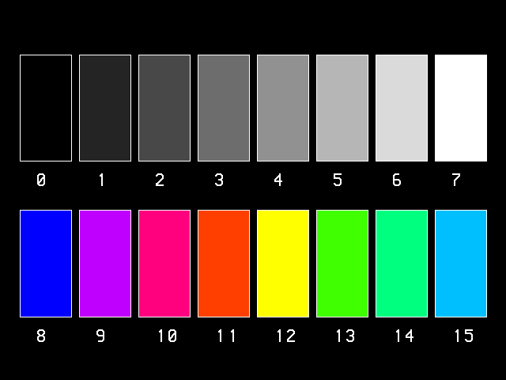

Entry 0 is black and entry 7 is white. The hues start at blue and go round the colour circle through magenta, red, yellow and green to cyan.

**SELECT COLOR** chooses the entry to draw with: `select(11)`. Everything after it, shapes and text alike, uses that entry.

**SET COLOR** changes the colour the selected entry holds. The helper's `define(entry, red, green, blue)` does both:

```python
page = SO + reset_all()
palette = [(0x1B, 0x26, 0x4F), (0x27, 0x4C, 0x77), (0x60, 0x96, 0xBA), (0xA3, 0xCE, 0xF1), (0xE7, 0xEC, 0xEF)]
for index, (red, green, blue) in enumerate(palette):
    page += define(8 + index, red, green, blue)
for index in range(5):
    page += select(8 + index) + pdi(SET_RECT_FILLED, xy(0, 0.78 - (index + 1) * 0.157), xy(0.999, 0.157))
page += select(BLACK) + text_at(0.06, 0.05, "five entries of the map, redefined")
```

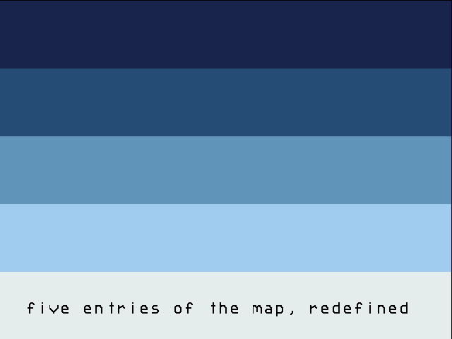

A colour operand has six bits per primary in its three bytes, so 64 levels each of red, green and blue.

**Changing an entry changes everything already drawn with it.** The picture is stored as entry numbers, not colours. This is the most useful fact in NAPLPS: draw a scene once, then recolour entries to turn day into night, make water shimmer or reveal something hidden, at a cost of nine bytes per colour change. [Section 13](#13-time) uses it.

Plan the map before you draw. Sixteen entries is the budget for the whole page; leaving 0 as black and 7 as white keeps text legible while you work, and a palette of five to eight related colours usually looks better than all sixteen.

There are three **colour modes**. The examples use mode 1 (colour map) throughout. Mode 2 adds a background colour that text and textures paint behind themselves, `select(BLACK, YELLOW)`, as in section 8. Mode 0 takes an RGB colour directly with SET COLOR and lets the terminal find a map entry for it; it is the power-up default, which is one more reason to start with a RESET that selects mode 1. Details are in the [reference](reference.md#colour).

## 7. Lines and fills

**TEXTURE** sets how lines are drawn and how filled shapes are filled, in one operand byte: the fill pattern in bits 6 to 4, a highlight flag in bit 3, the line texture in bits 2 and 1.

```python
page = SO + reset_all() + select(WHITE)
# DOMAIN: one-byte single values, three-byte coordinates, and a logical pel of 1/256 by 1/256.
# Line textures and hatching are measured in pels: with the default pel, lines stay solid.
page += pdi(DOMAIN, fixed(0b001000), xy(1 / 256, 1 / 256))
# Line textures 0 to 3: solid, dotted, dashed, dot-dash.
for texture in range(4):
    y = 0.72 - texture * 0.05
    page += pdi(TEXTURE, fixed(texture)) + pdi(SET_LINE_ABS, xy(0.05, y), xy(0.95, y))
# Fill patterns 0 to 3: solid, vertical, horizontal and cross hatching.
for pattern in range(4):
    x = 0.05 + pattern * 0.235
    page += select(YELLOW) + pdi(TEXTURE, fixed(pattern << 3))
    page += pdi(SET_RECT_FILLED, xy(x, 0.30), xy(0.19, 0.19))
# The same with highlight: the outline drawn in black (in mode 2, in the background colour).
for pattern in range(4):
    x = 0.05 + pattern * 0.235
    page += select(CYAN) + pdi(TEXTURE, fixed(pattern << 3 | 0b100))
    page += pdi(SET_ARC_FILLED, xy(x, 0.14), xy(0.19, 0))
```

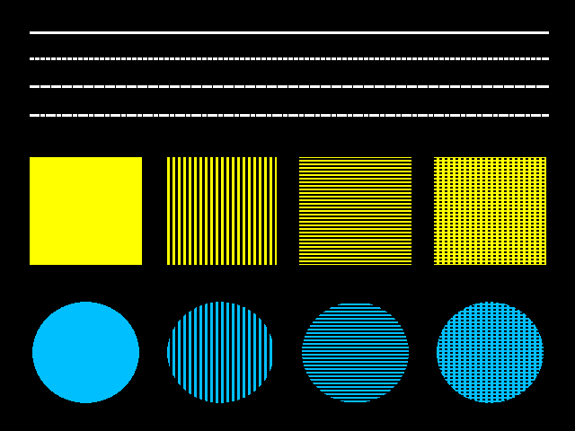

The **logical pel** is NAPLPS's brush: a small rectangle stamped along every line. It is set by DOMAIN, the command that also sets operand lengths. With a pel of 1/256 the lines above are three pixels thick at 640 by 480, and the dots, dashes and hatching are measured in the same pel. A larger pel gives thicker lines and coarser hatching: a pel of 1/64 draws with a marker.

After a RESET the pel is the smallest the display can show (one pixel), and **line textures need a real pel**: with the default, textured lines are drawn solid. Send a DOMAIN with a pel if you use them.

Hatching leaves gaps, and what shows in the gaps is whatever was there before (in colour mode 2, the background colour). Hatch over a solid fill of a second colour for two-colour shading.

Four more fill patterns, numbers 4 to 7, are yours to define: [section 11](#11-your-own-characters).

## 8. Text

Text is drawn in a **character field**, a rectangle whose size you control. The default is 1/40 of the screen wide and 5/128 high: 40 columns by 20 rows.

```python
page = SO + reset_all() + select(WHITE)
page += text_at(0.04, 0.70, "Normal text: 40 columns by 20 rows")
page += SI + SMALL_TEXT + SO + text_at(0.04, 0.65, "SMALL TEXT: 80 columns")
page += SI + MEDIUM_TEXT + SO + text_at(0.04, 0.59, "MEDIUM TEXT: 32 columns")
page += SI + DOUBLE_HEIGHT + SO + text_at(0.04, 0.49, "DOUBLE HEIGHT")
page += SI + DOUBLE_SIZE + SO + text_at(0.04, 0.39, "DOUBLE SIZE")
page += SI + NORMAL_TEXT + SO
page += select(YELLOW) + pdi(POINT_SET_ABS, xy(0.04, 0.32)) + SI
page += UNDERLINE_START + b"underlined" + UNDERLINE_STOP + b"  " + REVERSE_VIDEO + b"reversed" + NORMAL_VIDEO + SO
# TEXT: proportional spacing (first byte, bits 6 and 5 = 11) and a 1/16 by 1/10 field.
page += select(CYAN) + pdi(TEXT, fixed(0b110000, 0), xy(1 / 16, 1 / 10))
page += text_at(0.04, 0.17, "Proportional")
# TEXT: rotated a quarter turn (bits 2 and 1 = 01) and running upward (bits 4 and 3 = 10).
page += select(GREEN) + pdi(TEXT, fixed(0b001001, 0), xy(1 / 32, 3 / 64))
page += text_at(0.97, 0.08, "rotated, path up")
# Colour mode 2: text on a background colour.
page += pdi(TEXT, fixed(0, 0), xy(1 / 40, 5 / 128)) + select(BLACK, YELLOW)
page += text_at(0.04, 0.05, " black on yellow, colour mode 2 ")
```

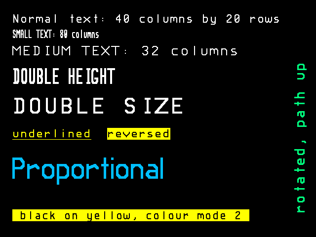

There are two ways to change how text looks.

**The C1 controls** are two-byte escape sequences that set one thing each: five preset sizes, underline, reverse video. They are the quick way to get the standard sizes.

**The TEXT command** is a PDI that sets everything at once:

- its first byte holds the **spacing** between characters (1, 5/4, 3/2 of the field, or proportional), the **path** the text runs along (right, left, up, down) and the **rotation** of each character (0, 90, 180, 270 degrees);
- its second byte holds the cursor style, how the cursor and drawing point move together, and the **spacing between rows**;
- then a coordinate pair gives the field's width and height, any size you like.

Rotation turns the characters; path moves the cursor. Vertical text that reads upward needs both, as above. Rotation alone gives sideways letters marching to the right.

The font is made of strokes, so it scales to any field size, and the stroke thickness grows with the field.

**Proportional spacing** closes up the gaps a fixed pitch leaves around narrow letters. Use it for anything that should read as typeset rather than as a terminal.

Line breaks are yours to send: CR (`0D`) returns to the left edge and LF (`0A`) moves down a row, so `b"first\r\nsecond"` is two lines. A line that reaches the right edge continues on the next row, but breaks wherever it happens to be: **this renderer does not word-wrap**.

Accented letters and symbols come from the supplementary set, one character at a time through SS2 (`19`). An accent is sent before its letter: `SS2 + b"\x42" + b"e"` is é. The whole set is pictured in the [reference](reference.md#the-supplementary-set).

## 9. Mosaics

Mosaic characters are the block graphics of teletext: each character field is divided into two columns and three rows of cells, and the character's code says which cells are filled.

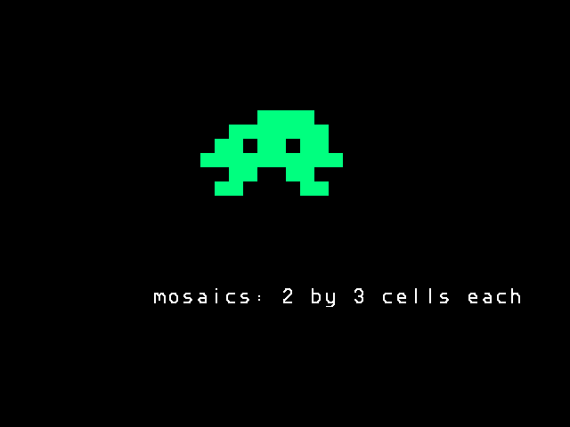

The mosaic set starts in G3, reached one character at a time with SS3 (`1D`). The code is `20` plus one bit per cell:

```
+----+----+
| 01 | 02 |
+----+----+
| 04 | 08 |
+----+----+
| 10 | 40 |
+----+----+
```

So `SS3 + b"\x7f"` is a full block and `SS3 + b"\x23"` is the top row. Mosaics take the text size, so `DOUBLE_SIZE` makes big blocks, and underline mode turns them into *separated* mosaics with a gap round each cell.

Mosaics are compact for coarse pictures and textures, and they are the bridge from teletext art. For anything smooth, polygons are both smaller and better looking.

## 10. Macros

A macro is a stored piece of page that you replay by sending one byte. Anything can go in a macro: drawing, text, colour changes, other macros. They are how pages stay small.

```python
page = SO + reset_all() + MACROS_INTO_G3
# Macro 2/1: a small four-pointed star at the drawing point, using relative PDIs only.
star = pdi(POLY_FILLED, xy(0.012, 0.03), xy(0.012, -0.03), xy(-0.012, -0.03), xy(-0.012, 0.03))
star += pdi(POINT_SET_REL, xy(-0.012, -0.012))
star += pdi(POLY_FILLED, xy(0.012, 0.012), xy(0.012, -0.012), xy(0.012, 0.012), xy(-0.012, 0.012), xy(-0.012, -0.012))
page += DEF_MACRO + b"\x21" + SO + star + END
page += define(8, 0x0B, 0x13, 0x40) + pdi(SET_RECT_FILLED, xy(0, 0), xy(0.999, 0.78))
for index, (x, y) in enumerate(positions):
    page += select(WHITE if index % 3 else YELLOW) + pdi(POINT_SET_ABS, xy(x, y)) + SS3 + b"\x21"
```

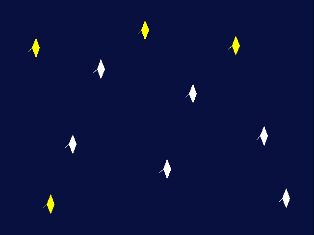

The steps:

1. **Make the macro set reachable.** `MACROS_INTO_G3` (`1B 2F 7A`) puts the macro set in G3, in place of the mosaics. Do it once.
2. **Define.** `DEF_MACRO`, then a name (any byte from `20` to `7F`; 96 macros), then the body, then `END`. Nothing is drawn while a DEF MACRO is recorded.
3. **Invoke.** `SS3` and the name. The body is processed as if it had been sent at that point.

The star is written with **relative** opcodes (`POLY_FILLED` starts at the drawing point), so it appears wherever the drawing point is, in whatever colour is selected. That is the pattern for any reusable symbol: position, colour, invoke.

Start the body with SO or SI. A macro replays bytes, not meanings: if the page is in text mode when you invoke a macro that assumes the PDI set, its opcodes come out as letters.

`DEFP_MACRO` defines a macro and runs it at the same time, which saves sending the first use twice. Macros may invoke other macros, sixteen deep.

## 11. Your own characters

A **DRCS** character (dynamically redefinable character set) is a shape you draw once and then use as a letter: it follows the text size, colour, rotation, cursor and REPEAT like any character.

```python
page = SO + reset_all() + DRCS_INTO_G3 + select(RED)
# DEF DRCS 2/1: a heart, drawn in a unit square that becomes the character field.
heart = pdi(SET_ARC_FILLED, xy(0.10, 0.65), xy(0.40, 0)) + pdi(SET_ARC_FILLED, xy(0.50, 0.65), xy(0.40, 0))
heart += pdi(SET_POLY_FILLED, xy(0.12, 0.56), xy(0.76, 0), xy(-0.38, -0.50))
page += pdi(TEXT, fixed(0, 0), xy(1 / 16, 1 / 16)) + DEF_DRCS + b"\x21" + SO + heart + END
for row in range(4):
    page += select([RED, MAGENTA_RED, YELLOW, WHITE][row]) + pdi(POINT_SET_ABS, xy(0.12 + row * 0.03, 0.60 - row * 0.15))
    page += SS3 + b"\x21" + REPEAT + fixed(9)
```

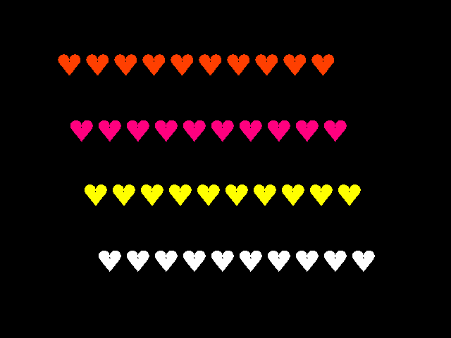

Between `DEF_DRCS` and `END`, drawing goes into the character instead of onto the screen. You draw as if the character field were the whole screen: its longer side is the unit length, so a square field is the unit square, (0, 0) to (1, 1). The shape is kept as a one-colour bitmap and drawn in whatever colour is selected when you use it.

Set the text size before you define: the character takes the shape of the current field.

`REPEAT` and a count (`ESC 46`, then one operand byte, up to 63) draws the last character again that many times. Ten hearts cost four bytes.

**Your own fill patterns** work the same way. `DEF_TEXTURE` and a name from `41` to `44` (A to D) records a drawing as fill pattern 4 to 7, tiled at the mask size that TEXTURE's second operand sets. Then `pdi(TEXTURE, fixed(4 << 3))` fills with it:

```python
page = SO + reset_all()
# TEXTURE's second operand is the mask size: the pattern repeats every 1/16 of the screen.
page += pdi(TEXTURE, fixed(0), xy(1 / 16, 1 / 16))
# DEF TEXTURE A (fill pattern 4): a diagonal stripe drawn in the unit square.
page += DEF_TEXTURE + b"\x41" + SO + pdi(SET_POLY_FILLED, xy(0, 0), xy(0.3, 0), xy(0.69, 0.999), xy(-0.3, 0)) + END
page += select(BLUE) + pdi(SET_RECT_FILLED, xy(0.10, 0.14), xy(0.80, 0.50))
page += select(YELLOW) + pdi(TEXTURE, fixed(4 << 3), xy(1 / 16, 1 / 16)) + pdi(SET_RECT_FILLED, xy(0.10, 0.14), xy(0.80, 0.50))
```

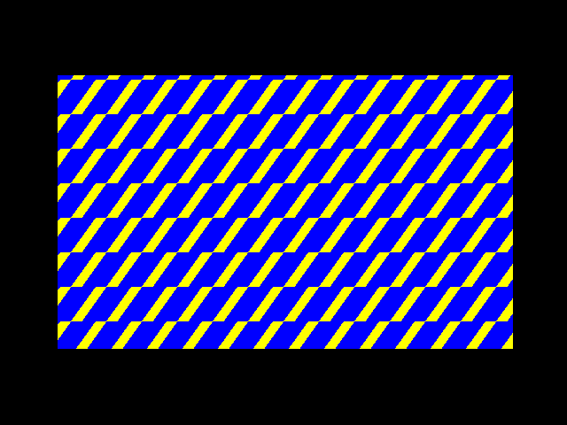

The pattern's gaps leave what was underneath, so the blue rectangle drawn first shows between the stripes.

## 12. Scribbles

Curves and outlines that would take three bytes a point as a polyline take **two bits a move** as an incremental line.

```python
page = SO + reset_all() + select(GREEN)
# INCREMENTAL LINE: a step size, then two-bit moves: 01 dx, 10 dy, 11 both, 00 an escape.
page += pdi(POINT_SET_ABS, xy(0.05, 0.30)) + pdi(INCREMENTAL_LINE, xy(1 / 64, 1 / 32)) + data
```

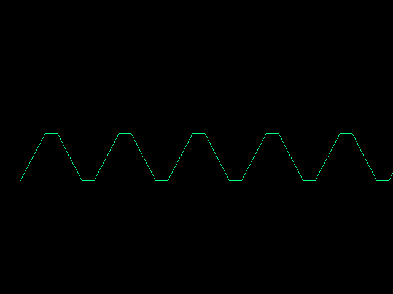

The first operand is a step, (dx, dy). After it, each byte holds three moves of two bits:

| Bits | Move |
|---|---|
| `01` | by dx |
| `10` | by dy |
| `11` | by dx and dy |
| `00` | escape: the next two bits are an instruction, not a move |

After an escape: `00` lifts or lowers the pen, `01` reverses dx, `10` reverses dy, `11` reverses both. The zigzag above climbs with `11`, runs flat with `01`, then sends `00 10` to turn dy downward.

`INCREMENTAL_POLY_FILLED` reads the same moves and fills the outline they trace, which is how period artists drew coastlines and faces cheaply. `INCREMENTAL_POINT` is a bitmap: a rectangle of pels, each with its own colour, for the rare place only a bitmap will do.

## 13. Time

A page is drawn in the order its bytes arrive, and in 1983 they arrived at 120 characters a second: every page was an animation of its own drawing. Two commands let you control time deliberately.

**WAIT** pauses. `wait(15)` holds for a second and a half before what follows. Use it to reveal a page in stages.

**BLINK** makes a colour-map entry alternate between its own colour and another entry's colour, on a schedule, for ever:

```python
page = SO + reset_all()
page += define(8, 0x10, 0x10, 0x30) + pdi(SET_RECT_FILLED, xy(0, 0), xy(0.999, 0.78))
page += define(9, 0xFF, 0xD0, 0x40) + pdi(SET_ARC_FILLED, xy(0.38, 0.39), xy(0.24, 0))
page += select(WHITE) + text_at(0.36, 0.12, "blinking beacon")
# BLINK: entry 9 (selected) takes entry 8's colour for 5 tenths, then its own for 5.
page += select(9) + pdi(BLINK, fixed(8 << 2, 5, 5, 0))
```

| At the start | Half a second later |
|---|---|
| 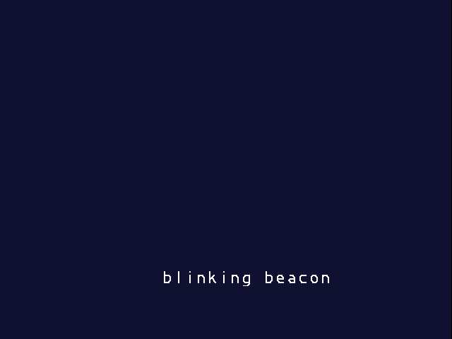 | 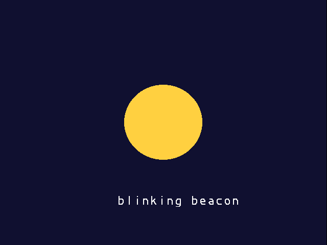 |

The beacon was drawn once, in entry 9. BLINK then gives entry 9 the background's colour for half a second, its own for half a second, and so on. Nothing is redrawn.

Several BLINKs with different delays make a chase: draw a ring of lamps in entries 9 to 12, blink each with the same intervals and a delay one step later than the last, and the light runs round the ring. With WAIT and SET COLOR you can also change entries by hand, one step at a time: a sunset is a WAIT and three SET COLORs, repeated.

To see time in this renderer:

- the library reports each WAIT as an event and carries on drawing, so the caller decides how to pause. `naplps-render` draws the whole page, pauses ignored;
- `naplps-render --tenths N` shows the colour map as BLINK has it N tenths of a second after the first BLINK began. Render at several values to see each state.

## 14. A whole page

This postcard uses most of the above in 263 bytes: a seven-colour palette defined up front, flat shapes drawn back to front, a macro for the ripples, and proportional display type.

```python
page = SO + reset_all() + MACROS_INTO_G3
sky, sun, far, near, sea, foam, ink = 8, 9, 10, 11, 12, 13, 14
for entry, colour in [(sky, (0xF6, 0xB2, 0x6B)), (sun, (0xFF, 0xF1, 0xC1)), ...]:
    page += define(entry, *colour)
page += select(sky) + pdi(SET_RECT_FILLED, xy(0, 0), xy(0.999, 0.78))
page += select(sun) + circle(0.68, 0.47, 0.13)
page += select(far) + polygon([(0, 0.30), (0.14, 0.44), (0.27, 0.36), ...])
page += select(near) + polygon([(0, 0.25), (0.10, 0.34), (0.22, 0.27), ...])
page += select(sea) + pdi(SET_RECT_FILLED, xy(0, 0), xy(0.999, 0.26))
# Macro 2/1: one ripple, a thin bar at the drawing point.
page += DEF_MACRO + b"\x21" + SO + pdi(RECT_FILLED, xy(0.07, 0.006)) + END
page += select(foam)
for x, y in ripples:
    page += pdi(POINT_SET_ABS, xy(x, y)) + SS3 + b"\x21"
page += select(ink) + pdi(TEXT, fixed(0b110000, 0), xy(1 / 14, 1 / 9)) + text_at(0.05, 0.62, "DUSK")
```

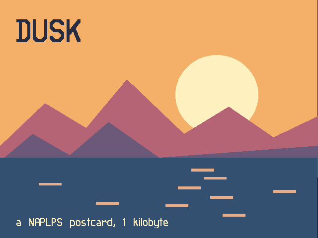

How pages like this are put together:

1. **Palette first.** Choose the colours and give them entry numbers before drawing anything. Name them in your code.
2. **Back to front.** There are no layers: later shapes cover earlier ones. Sky, then sun, then far hills, then near hills, then sea.
3. **Big flat shapes.** A polygon costs three bytes a vertex whatever its size. Detail is what costs.
4. **Macros for anything repeated**, written with relative opcodes.
5. **Text last**, so nothing covers it.

Because every entry is named, this page is one step from an animation: a WAIT, then new colours for `sky`, `sun` and `sea`, and dusk becomes night.

**Size is part of the craft.** Period pages were a few hundred bytes to a few kilobytes; at 1200 bits a second, each kilobyte was eight seconds of waiting. Ways to stay small: omit trailing zero operand bytes; use relative forms with short operands; draw rows of rectangles with one opcode; use incremental lines for irregular outlines; put anything used three times in a macro.

## 15. Checking a page

**Render it** and look at it, at 640 by 480 and at a larger size. Pages are resolution-independent, but a pel or a hatch chosen at one size can look different at another.

**Check it in period software** if exactness matters. This repository's oracle drives PP3, a 1980s NAPLPS terminal program, and captures its screen: see [`verification.md`](verification.md). The renderer agrees with PP3 to the pixel on most of the standard's features, and `verification.md` lists where it does not yet.

**Read it back.** `xxd -g1 page.nap` shows the bytes; with the [reference](reference.md) beside you, a page is readable in hex. SO and SI (`0E`, `0F`) and opcodes (`20`-`3F`) are the landmarks.

## 16. What goes wrong

| What you see | Why |
|---|---|
| Letters and punctuation where a drawing should be | The page was in text mode: send SO before PDIs. Or a macro body did not begin with SO. |
| Nothing drawn, or a shape in the wrong place | y is measured from the bottom and only 0 to 0.78 is visible. Or a polygon was given absolute points: it takes steps. |
| The first shape is missing | No RESET, and the terminal was in a state left by another page: mode, DOMAIN, or a definition still open. |
| A colour is wrong everywhere | SET COLOR changed an entry that earlier drawing used. Entries are shared by everything drawn with them. |
| SET COLOR seems to do nothing | Colour mode 0 is in force (the power-up default), where SET COLOR chooses a colour to draw with rather than defining an entry. `reset_all()` selects mode 1. |
| Textured lines are solid | The logical pel is at its default. Set one with DOMAIN (section 7). |
| Text is blank | No font was given to the renderer (`--font`). |
| Text wraps in mid-word | This renderer does not word-wrap. Send CR LF where lines should break. |
| Vertical text marches sideways | Rotation without path. Set both in TEXT (section 8). |
| A blinking shape is invisible in a still | BLINK starts in its ON interval, showing the other entry's colour. Render with `--tenths` (section 13). |
| A macro or DRCS character does nothing | Its set was not designated (`MACROS_INTO_G3`, `DRCS_INTO_G3`), or the other one replaced it in G3: use G2 and SS2 for one of them. |
| A shape near the right or top edge is cut or missing | 1.0 cannot be encoded; the helper clips to 255/256. Negative or overflowing steps wrap. |
