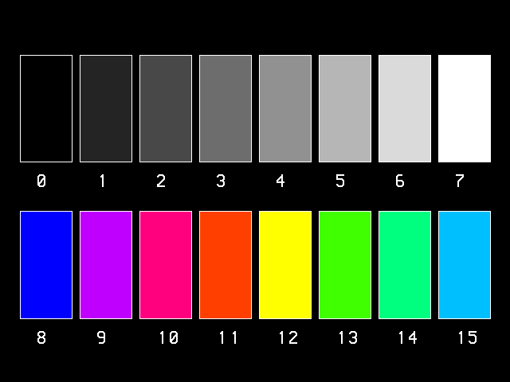
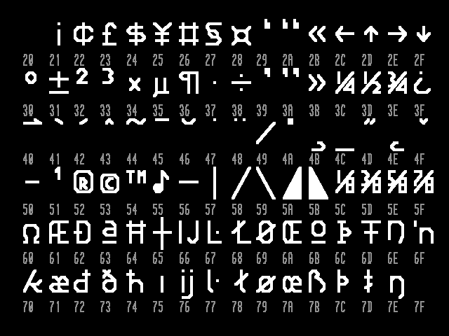

# NAPLPS page reference

Every byte a NAPLPS page can contain, what it does, and what this repository's renderer does with it. For a tutorial, read [`guide.md`](guide.md) first.

The standard is ANSI X3.110-1983, identical in substance to CSA T500-1983; section numbers below are the standard's. Where the standard leaves a choice open, or this renderer does less than the standard asks, the entry says **Here:**. [The last section](#what-this-renderer-does-not-do) collects those.

Bytes are written in hexadecimal. The standard's own notation is column/row: `3/14` is `3E`. Operand bits are numbered as the standard numbers them, **b7 to b1**, where b7 is always 1 in the 7-bit form and b6 to b1 are the six data bits.

Contents: [The code table](#the-code-table) · [Sets and shifts](#sets-and-shifts) · [C0 controls](#c0-controls) · [C1 controls](#c1-controls) · [Operands](#operands) · [PDIs](#pdis) · [Colour](#colour) · [Text](#text) · [Mosaics](#mosaics) · [Macros](#macros) · [DRCS](#drcs) · [Fill patterns](#fill-patterns) · [The display](#the-display) · [Limits](#limits) · [Tools](#tools) · [What this renderer does not do](#what-this-renderer-does-not-do)

## The code table

| Bytes | 7-bit form | 8-bit form |
|---|---|---|
| `00`-`1F` | C0 controls | C0 controls |
| `20`-`7F` | GL: the set shifted in (G0 at first) | GL |
| `80`-`9F` | not used; C1 is sent as ESC `40`-`5F` | C1 controls |
| `A0`-`FF` | not used | GR: the set shifted in (G1 at first) |

A terminal holds four sets, **G0 to G3**, chosen from six. Shifts decide which of the four the bytes `20`-`7F` (and `A0`-`FF`) mean.

| Set | Holds | Designated by final byte |
|---|---|---|
| Primary | ASCII | `42` |
| Supplementary | accents, symbols, other letters | `7C` |
| PDI | drawing opcodes and operands | `57` |
| Mosaic | 2 by 3 block graphics | `7D` |
| Macro | 96 macro names | `7A` |
| DRCS | 96 characters you define | `7B` |

At power-up and after NSR: **G0 primary, G1 PDI, G2 supplementary, G3 mosaic**; G0 in GL and G1 in GR.

### The 8-bit form

With eight bits, text is sent as `20`-`7F` and drawing as `A0`-`FF` (each PDI byte with its top bit set) with no SO or SI between them, and each C1 control is one byte, `80`-`9F`. Prodigy's pages are in this form. A page may mix both forms; this renderer accepts either at any time.

## Sets and shifts

**Designation** puts a set into G0 to G3: `ESC`, an intermediate byte naming the G-set, and the set's final byte from the table above.

| Intermediate | G-set |
|---|---|
| `28` | G0 (primary and supplementary sets only, by the standard) |
| `29` or `2D` | G1 |
| `2A` or `2E` | G2 |
| `2B` or `2F` | G3 |

So `1B 2F 7A` puts the macro set in G3 and `1B 2A 7B` puts the DRCS in G2. **Here:** a further intermediate byte `20` before the final byte is accepted and ignored (`1B 2E 20 7A`), as other NAPLPS and T.101 documents write these sequences; unknown final bytes leave the G-set unchanged.

**Invocation** chooses which G-set the bytes mean.

| Bytes | Name | Effect |
|---|---|---|
| `0F` | SI (LS0) | G0 into GL |
| `0E` | SO (LS1) | G1 into GL |
| `1B 6E` | LS2 | G2 into GL |
| `1B 6F` | LS3 | G3 into GL |
| `1B 7E` | LS1R | G1 into GR |
| `1B 7D` | LS2R | G2 into GR |
| `1B 7C` | LS3R | G3 into GR |
| `19` | SS2 | the next byte only is taken from G2 |
| `1D` | SS3 | the next byte only is taken from G3 |

A shift does not end a PDI that is collecting operands. Every other C0 control and every C1 control does.

Other escape sequences (`1B 21 ...`, `1B 22 46` announcing the C1 set, `1B 25 ...`) are read and have no effect.

## C0 controls

| Byte | Name | Effect |
|---|---|---|
| `07` | BEL | **Here:** reported to the caller as an event. |
| `08` | APB | Cursor back one character; at the start of a line, to the end of the line above. |
| `09` | APF | Cursor forward one character; at the end of a line, to the start of the next. |
| `0A` | APD | Cursor down one row (line feed). At the bottom: to the top, or scroll in scroll mode. |
| `0B` | APU | Cursor up one row. |
| `0C` | CS | Clear the screen to nominal black (in colour mode 2, to the background colour) and home the cursor. Inside DEF DRCS or DEF TEXTURE, clears the definition instead. |
| `0D` | APR | Cursor to the start of the line (carriage return). |
| `0E` `0F` | SO SI | See [shifts](#sets-and-shifts). |
| `18` | CAN | Ends every macro being executed. |
| `19` `1D` | SS2 SS3 | See [shifts](#sets-and-shifts). |
| `1B` | ESC | Begins an escape sequence. |
| `1C` | APS | Cursor to a row and column, given by the next two bytes, each `20` plus the number, in character fields of the current size. **Here:** rows are counted upward from the bottom of the screen; this has not been checked against PP3. |
| `1E` | APH | Cursor to the home position, the top left character field. |
| `1F` | NSR | Non-selective reset: sets and shifts, DOMAIN, text attributes, textures and colour mode 0 return to their defaults; the colour map, macros, DRCS and fill patterns are kept. May be followed by two bytes `40`-`7F` giving a row and column from the top left. |

`00`-`06` and `10`-`17` belong to other layers of a system; they do nothing and do not end a PDI. Cursor movements move the drawing point with them unless TEXT has separated the two.

## C1 controls

Sent as `ESC` and the byte in the second column, or in the 8-bit form as the single byte in the first.

| 8-bit | 7-bit | Name | Effect |
|---|---|---|---|
| `80` | `1B 40` | DEF MACRO | Begin recording a [macro](#macros); the next byte is its name. |
| `81` | `1B 41` | DEFP MACRO | The same, and the bytes are also executed as they arrive. |
| `82` | `1B 42` | DEFT MACRO | A transmit macro. **Here:** stored like any macro; nothing is transmitted. |
| `83` | `1B 43` | DEF DRCS | Begin defining a [DRCS](#drcs) character; the next byte is its code. |
| `84` | `1B 44` | DEF TEXTURE | Begin defining a [fill pattern](#fill-patterns); the next byte is `41`-`44`. |
| `85` | `1B 45` | END | Ends a definition. Any of `80`-`84` also ends one and begins the next. |
| `86` | `1B 46` | REPEAT | The next byte, `40`-`7F`, is a count 0 to 63: draw the last spacing character that many more times. |
| `87` | `1B 47` | REPEAT TO EOL | Draw the last spacing character to the end of the line. |
| `88` | `1B 48` | REVERSE VIDEO | Characters are drawn with field and strokes exchanged. |
| `89` | `1B 49` | NORMAL VIDEO | Ends reverse video. |
| `8A` | `1B 4A` | SMALL TEXT | Character field 1/80 by 5/128. |
| `8B` | `1B 4B` | MEDIUM TEXT | Character field 1/32 by 3/64. |
| `8C` | `1B 4C` | NORMAL TEXT | Character field 1/40 by 5/128. |
| `8D` | `1B 4D` | DOUBLE HEIGHT | Character field 1/40 by 5/64. |
| `8E` | `1B 4E` | BLINK START | The current colour blinks to black (mode 2: to the background). **Here:** half a second each way. |
| `8F` | `1B 4F` | DOUBLE SIZE | Character field 1/20 by 5/64. |
| `90` | `1B 50` | PROTECT | **Here:** no effect. |
| `91`-`94` | `1B 51`-`54` | EDC1-EDC4 | Device controls. No effect. |
| `95` `96` | `1B 55` `56` | WORD WRAP ON, OFF | **Here:** recorded, not applied: lines break at the edge. |
| `97` `98` | `1B 57` `58` | SCROLL ON, OFF | A line feed at the last row scrolls the text area instead of wrapping to the top. |
| `99` `9A` | `1B 59` `5A` | UNDERLINE START, STOP | Characters are underlined; mosaics are drawn separated. |
| `9B`-`9D` | `1B 5B`-`5D` | FLASH CURSOR, STEADY CURSOR, CURSOR OFF | **Here:** no effect; no cursor is drawn. |
| `9E` | `1B 5E` | BLINK STOP | Ends blinking of the current colour. |
| `9F` | `1B 5F` | UNPROTECT | **Here:** no effect. |

## Operands

In the PDI set, `20`-`3F` are opcodes and `40`-`7F` are operand bytes, each carrying six bits (b6 to b1). A PDI is an opcode and every operand byte up to the next byte that is not one. There are four kinds of operand.

**Fixed format**: one byte whose bits are flags, laid out differently for each command.

**Single value**: an unsigned number, six bits per byte, most significant first. One byte unless DOMAIN changes it (1 to 4). Used for colour-map entries.

**Multi-value**: a coordinate pair. Three bytes unless DOMAIN changes it (1 to 8). Each byte holds three bits of x (b6 to b4) and three of y (b3 to b1), most significant first, so n bytes give 3n bits to each coordinate: one sign bit, then 3n - 1 bits of binary fraction, in two's complement. With three bytes a coordinate is a multiple of 1/256 from -1 to 255/256.

```
(0.35, 0.40):  x = 0 01011010   y = 0 01100110
               49 = 1 001 001   5C = 1 011 100   56 = 1 010 110
(-0.25, 0):    x = 1 11000000   y = 0 00000000
               78 = 1 111 000   40 = 1 000 000   40 = 1 000 000
```

In three-dimensional mode each byte holds two bits each of x, y and z. **Here:** z is read and ignored.

**Colour**: a multi-value operand whose bytes hold two bits of each primary in the order green, red, blue, green, red, blue (b6 to b1), most significant first. Three bytes give six bits a primary. A value of all ones is full intensity.

```
red 255, green 208, blue 64 -> 6 bits each: R 111111, G 110100, B 010000
byte 1: G1 R1 B0 G1 R1 B1 = 110111 -> 77
byte 2: G0 R1 B0 G1 R1 B0 = 010110 -> 56
byte 3: G0 R1 B0 G0 R1 B0 = 010010 -> 52
```

**Short operands.** If a PDI's data ends partway through an operand, the missing bytes count as zero, so trailing zero bytes of the last operand may be omitted. A PDI with fewer operands than it needs does what the entry below says, usually nothing.

## PDIs

"Drawing point" is the current position, left by the previous PDI. Where an entry says an operand repeats, any number may follow.

### RESET `20`

Two fixed bytes; a missing byte is zero. Actions are taken in this order.

| Byte 1 | Meaning |
|---|---|
| b1 | DOMAIN to its default: one-byte single values, three-byte multi-values, two dimensions, the smallest logical pel. |
| b3 b2 | Colour. `01`: colour mode 0, the default colour map, white selected. `10`: the default colour map (in mode 0, also mode 1 and white). `11`: colour mode 1, the default colour map, white selected. |
| b6 b5 b4 | Screen. `001` or `111`: clear to nominal black. `010`, `101` or `110`: clear to the current drawing colour. `011` and `100` concern the border only. **Here:** there is no border. |

| Byte 2 | Meaning |
|---|---|
| b1 | Text attributes to their defaults, the active field removed, cursor home. |
| b2 | All blinking stopped. |
| b3 | Unprotected fields. **Here:** no effect. |
| b4 | Line texture solid, fill pattern solid, highlight off, mask size 1/40 by 5/128. |
| b5 | Every macro deleted. |
| b6 | Every DRCS character deleted. |

`20 7F 7F` resets everything and clears the screen: the right way to begin a page.

### DOMAIN `21`

One fixed byte, then a multi-value operand (in the new lengths) giving the **logical pel**: the width and height of the brush.

| Bits | Meaning |
|---|---|
| b6 | 1: three-dimensional coordinates |
| b5 b4 b3 | bytes in a multi-value operand, less one (`010` is three) |
| b2 b1 | bytes in a single-value operand, less one |

`21 48 40 40 49` is the default lengths with a pel of 1/256 by 1/256. A pel dimension of zero means the smallest the display can show. A negative dimension draws the pel leftward or downward from each point.

Lines are stamped with the pel from each point rightward and upward. **Here:** the pel is rounded up to whole pixels (1/256 is 3 by 3 pixels at 640 by 480), and line textures and hatching are measured in it.

### TEXT `22`

Two fixed bytes and a multi-value operand; anything omitted is left unchanged.

| Byte 1 | Meaning |
|---|---|
| b6 b5 | Spacing between characters: `00` 1, `01` 5/4, `10` 3/2 of the field's width; `11` proportional. |
| b4 b3 | Path: `00` right, `01` left, `10` up, `11` down. |
| b2 b1 | Rotation of each character: `00` 0, `01` 90, `10` 180, `11` 270 degrees counterclockwise. |

| Byte 2 | Meaning |
|---|---|
| b6 b5 | Cursor style: underscore, block, cross-hair, custom. **Here:** recorded only. |
| b4 b3 | `00` cursor and drawing point move together; `01` cursor leads; `10` drawing point leads; `11` independent. |
| b2 b1 | Spacing between rows: `00` 1, `01` 5/4, `10` 3/2, `11` 2 of the field's height. |

The multi-value operand is the character field's width and height. See [Text](#text).

### TEXTURE `23`

One fixed byte, then an optional multi-value operand: the **mask size**, the width and height at which a defined fill pattern repeats (default 1/40 by 5/128).

| Bits | Meaning |
|---|---|
| b6 b5 b4 | Fill pattern: `000` solid, `001` vertical hatching, `010` horizontal, `011` cross-hatching, `100`-`111` [defined patterns](#fill-patterns) A to D. |
| b3 | Highlight: filled shapes are outlined in nominal black (mode 2: the background colour). |
| b2 b1 | Line texture: `00` solid, `01` dotted, `10` dashed, `11` dot-dash. |

Hatching lines are one pel wide and one pel apart. Dotted is one pel on, one off; dashed three on, one off; dot-dash three on, one off, one on, one off. Gaps leave what was there, or in colour mode 2 take the background colour. **Here:** a line is textured only if the pel has a size along it; with the default pel, lines are solid.

### POINT `24`-`27`

| Opcode | Name | Operands |
|---|---|---|
| `24` | POINT SET (absolute) | a point: the drawing point moves there |
| `25` | POINT SET (relative) | a step: the drawing point moves by it |
| `26` | POINT (absolute) | a point: move there and draw one pel |
| `27` | POINT (relative) | a step: move and draw one pel |

Operands repeat.

### LINE `28`-`2B`

| Opcode | Name | Operands |
|---|---|---|
| `28` | LINE (absolute) | end point, repeating: from the drawing point to each in turn |
| `29` | LINE (relative) | step, repeating |
| `2A` | SET & LINE (absolute) | start point, then end points |
| `2B` | SET & LINE (relative) | start point, then steps |

The drawing point is left at the last end.

### ARC `2C`-`2F`

| Opcode | Name | Operands |
|---|---|---|
| `2C` | ARC (outlined) | step to a middle point, step to the end point |
| `2D` | ARC (filled) | the same; the area between arc and chord is filled |
| `2E` | SET & ARC (outlined) | start point, then the two steps |
| `2F` | SET & ARC (filled) | start point, then the two steps |

The arc starts at the drawing point (or the start point), passes through the middle point and ends at the end point; each step is relative to the point before it. With **one** step, the arc is the full circle whose diameter runs from the start to that point, and the drawing point does not move. With two steps the drawing point is left at the end.

**Here:** more than two steps describe a curve through all the points, which the standard draws as a spline; it is drawn as straight segments. Circles are true circles on the unit screen.

### RECTANGLE `30`-`33`

| Opcode | Name | Operands |
|---|---|---|
| `30` | RECT (outlined) | width and height, repeating |
| `31` | RECT (filled) | width and height, repeating |
| `32` | SET & RECT (outlined) | corner, then width and height, repeating |
| `33` | SET & RECT (filled) | corner, then width and height, repeating |

One corner is the drawing point; width and height may be negative. Afterwards the drawing point has moved **horizontally by the width**, so each further operand draws an adjoining rectangle.

### POLYGON `34`-`37`

| Opcode | Name | Operands |
|---|---|---|
| `34` | POLY (outlined) | step to each next vertex, repeating |
| `35` | POLY (filled) | the same |
| `36` | SET & POLY (outlined) | first vertex, then steps |
| `37` | SET & POLY (filled) | first vertex, then steps |

The first vertex is the drawing point (or the given point); every later operand is a **step from the previous vertex**. The polygon is closed back to the first vertex, and the drawing point is left there. Self-crossing polygons are filled by the even-odd rule. **Here:** up to 4096 vertices.

### FIELD `38`

| Operands | Effect |
|---|---|
| origin and size | The active field is that rectangle. |
| size only | The active field has its origin at the drawing point. |
| none | The active field is the whole display. |

The drawing point moves to the field's origin. The field is where INCREMENTAL POINT draws, and where text wraps and scrolls when the character field fits inside it. Unprotected (input) fields are also made with FIELD. **Here:** they are not recorded.

### INCREMENTAL POINT `39`

A bitmap. One fixed byte, the **packing**: bits per pel, 1 to 48. Then bits, six to a byte, read in groups of that size. Each group colours one pel: in colour mode 0 an RGB value (bits in the order G R B, repeating), otherwise a colour-map entry. Pels are laid from the drawing point across the active field, a pel's width at a time, moving up a pel's height at the end of each row, until the field is full or the data ends. The drawing point is left at the field's origin.

### INCREMENTAL LINE `3A`

A multi-value operand giving a step (dx, dy), then bytes of three two-bit moves each (b6 b5, b4 b3, b2 b1):

| Bits | Move |
|---|---|
| `01` | by dx |
| `10` | by dy |
| `11` | by dx and dy |
| `00` | escape: the next two bits are `00` pen up or down (toggles), `01` reverse dx, `10` reverse dy, `11` reverse both |

The pen starts down. The drawing point is left at the end.

### INCREMENTAL POLYGON (filled) `3B`

The same data as INCREMENTAL LINE; the outline traced is filled as a polygon. The pen escape has no meaning. The drawing point is left at the start.

### SET COLOR `3C`

See [Colour](#colour).

| Colour mode | Operands | Effect |
|---|---|---|
| 0 | a colour | Draw in that colour. |
| 1 or 2 | a colour, repeating | The selected entry takes the colour; each further colour goes to the next entry in the order below. |
| any | none | Selects the transparent colour. **Here:** black. |

"Next entry" is the standard's reversed counting: for a 16-entry map starting from 0, the order is 0, 8, 4, 12, 2, 10, 6, 14, 1, 9, 5, 13, 3, 11, 7, 15. To load consecutive entries, select each one.

### WAIT `3D`

A fixed byte `5C`, then interval bytes, each 0 to 63 tenths of a second, added together. Without the `5C` the command is ignored. **Here:** the library reports `Event::Wait(tenths)` and continues; pausing is the caller's business.

### SELECT COLOR `3E`

| Operands | Effect |
|---|---|
| none | Colour mode 0. |
| one single value | Colour mode 1; draw with that entry. |
| two single values | Colour mode 2; draw with the first entry on a background of the second. |

An entry is the operand's **most significant bits**: with one byte and a 16-entry map, entry e is `40 + 4e`. Entry 7 is `5C`; entry 12 is `70`.

### BLINK `3F`

Groups of four operands, repeating: a single value naming the **blink-to** entry, then three fixed bytes: the ON interval, the OFF interval and a start delay, in tenths of a second.

The selected entry shows the blink-to entry's colour for the ON interval, then its own for the OFF interval, repeatedly. A second group applies to the next entry (in the reversed counting above), and so on. The delay is measured from the start of the most recently defined blink. Intervals of zero, or a BLINK with no operands, end blinking of the selected entry. Blinks are applied in the order defined, so one blink can take the colour another has just produced. **Here:** up to 32 blinks at once.

## Colour

The picture is stored as **colour-map entry numbers**. The map has 2^n entries; 16 is the classic size and this renderer's default (`--palette-bits 4`), up to 256.

### The default colour map

The lower half of the map is greys, evenly spaced from black to white; the upper half is hues, evenly spaced round the colour circle from blue. For 16 entries:

| Entry | Colour | R G B | Entry | Colour | R G B |
|---|---|---|---|---|---|
| 0 | black | 0 0 0 | 8 | blue | 0 0 255 |
| 1 | | 36 36 36 | 9 | violet | 191 0 255 |
| 2 | | 72 72 72 | 10 | magenta-red | 255 0 127 |
| 3 | | 109 109 109 | 11 | red-orange | 255 63 0 |
| 4 | | 145 145 145 | 12 | yellow | 255 255 0 |
| 5 | | 182 182 182 | 13 | yellow-green | 63 255 0 |
| 6 | | 218 218 218 | 14 | green-cyan | 0 255 127 |
| 7 | white | 255 255 255 | 15 | cyan-blue | 0 191 255 |



Nominal black is entry 0 and nominal white is the last grey (7).

### Colour modes

| Mode | Entered by | SET COLOR | Drawing |
|---|---|---|---|
| 0 | SELECT COLOR with no operand; power-up; NSR | names an RGB colour to draw with | **Here:** the terminal finds an entry already holding that colour, or defines the lowest unused entry (never 0 or 7); with none left, the nearest colour. |
| 1 | SELECT COLOR with one operand | redefines the selected entry | in the selected entry |
| 2 | SELECT COLOR with two operands | redefines the selected entry | in the first entry; character fields, texture gaps and hatching gaps are painted in the second |

Redefining an entry recolours everything already drawn with it.

## Text

In a character set (primary, supplementary, mosaic, DRCS), a byte draws a character in the **character field** at the cursor and advances the cursor along the path.

- The field's size comes from TEXT or the C1 size controls; the default is 1/40 by 5/128 (40 by 20).
- The cursor is the field's lower left corner at rotation 0. It moves with the drawing point unless TEXT's second byte separates them, so POINT SET positions text.
- Past the end of a line the cursor moves to the start of the next row; past the last row it returns to the first, or the text area scrolls in scroll mode.
- In colour mode 2 the whole field is painted in the background colour first. In modes 0 and 1 only the strokes are drawn.
- Space advances and draws nothing (in mode 2, the background). `7F` is ignored.

**The font. Here:** the renderer has no font of its own. Primary and supplementary characters are drawn from a stroke font the caller supplies ([Tools](#tools)); without one they are blank. A stroke font is drawn on a 7 by 10 grid: grid x at x/8 of the field's width and y at y/10 of its height, with a square pen 1/12 of the field's height, as PP3 draws its font at the default size.

**Proportional spacing. Here:** on a horizontal path each glyph is moved so that its leftmost stroke is at the cursor, and the cursor advances by the glyph's width in strokes plus two eighths of the field. A space advances a whole field. On vertical paths spacing is fixed.

### The supplementary set

Reached with SS2 (`19`) for one character, or by shifting G2 in. `40`-`4F` are **non-spacing accents**: they draw without advancing, so an accent is sent before its letter (`19 42 65` is é, `19 48 75` is ü, `19 4B 63` is ç).



## Mosaics

Codes `20`-`3F` and `60`-`7F` of the mosaic set are block characters; `40`-`5E` are blank and `5F` is the full block. The field is divided into two columns and three rows, and each of six bits fills one cell:

| | left | right |
|---|---|---|
| top | b1 (`01`) | b2 (`02`) |
| middle | b3 (`04`) | b4 (`08`) |
| bottom | b5 (`10`) | b7 (`40`) |

`20` is empty, `7F` full. Mosaics take the text size, colour and rotation. While underline is on they are **separated**: each cell is drawn slightly smaller, leaving a gap. **Here:** the gap is a tenth of the field rather than one pel.

## Macros

`DEF MACRO`, a name byte `20`-`7F`, the body, `END`. The body is recorded, not executed; `DEFP MACRO` records and executes. The name is the character that will invoke the macro from the macro set.

- A body is ended by END or by any DEF control, which begins the next definition. Nothing else ends it: shifts, escapes and controls inside the body are recorded.
- Defining a macro with an empty body deletes it.
- A macro is invoked by its name byte in the macro set (designate it, then SS2 or SS3, or shift it in). Its bytes are processed as if received at that point, in the state the terminal is in then. An undefined name does nothing.
- Macros may invoke macros. A macro that invokes itself while being defined with DEFP is ignored.
- CAN (`18`) ends every macro being executed.
- RESET byte 2 b5 deletes all macros.

**Here:** a body may be 4096 bytes and all bodies together 65,536; nesting stops at 16 levels; and processing stops, with `Event::LimitReached`, after 4,000,000 bytes have been processed in one call, expansion included.

## DRCS

`DEF DRCS`, a code byte `20`-`7F`, drawing, `END`. While the definition is open, every PDI and character draws into the character's bitmap instead of the display.

- The bitmap has the shape of the character field at the time DEF DRCS is received. Coordinates inside it run from (0, 0) at its lower left, with the field's **longer side as 1**: a 1/16 by 1/16 field is the square (0, 0) to (1, 1); a default field, taller than wide, is 0.64 wide and 1 high.
- Only which pels are drawn is kept, not their colour. When used, the character is drawn in the current colour.
- The drawing point is at (0, 0) when the definition begins and afterwards.
- A DEF DRCS received while a DRCS definition is open ends it and begins the **next code** (after `7F`, `20`), with no code byte: consecutive characters need only one DEF DRCS each between their drawings.
- An undefined DRCS character is a space.
- RESET byte 2 b6 deletes all DRCS characters.

**Here:** the bitmap is 128 pixels on its longer side and is scaled to the field when drawn.

## Fill patterns

`DEF TEXTURE`, a byte `41`-`44` naming pattern A to D, drawing, `END`. The drawing is recorded like a DRCS character, in a bitmap shaped like the **mask size** (TEXTURE's second operand) at the time. TEXTURE fill patterns 4 to 7 then fill with A to D, repeating at the mask size across the screen from the origin, so that adjoining shapes filled with one pattern line up. Clear pels of the pattern leave what was there (mode 2: the background colour).

## The display

- The unit screen is 1 by 1 with (0, 0) at the lower left. A 4:3 display shows y from 0 to **25/32**. **Here:** this is measured from PP3, whose 480 lines show exactly 20 rows of 5/128; the canvas's full width is x from 0 to 1 and its full height is y from 0 to 25/32, whatever its shape.
- **Here:** coordinates are rounded to the nearest pixel. Filled shapes are also stroked along their edges with the pel, so a fill reaches as far as an outline of the same shape would.
- The power-up state: sets and shifts as [above](#the-code-table); default DOMAIN; colour mode 0 drawing in white on the default map; default text; cursor at home; drawing point at (0, 0).

## Limits

| What | Limit here |
|---|---|
| Canvas | 4096 by 4096 pixels |
| Colour map | 4 to 256 entries |
| Operand bytes kept for one PDI | 32,768; more are dropped |
| Vertices of a polygon, arc curve or incremental polygon | 4096 |
| One macro | 4096 bytes |
| All macros | 65,536 bytes |
| Macro nesting | 16 |
| Bytes processed in one call, with expansion | 4,000,000 |
| Blinks at once | 32 |
| DRCS or pattern bitmap | 128 pixels on the longer side |
| Characters drawn by one REPEAT TO EOL | 1024 |
| A page file read by `naplps-render` | 1 megabyte |

Period terminals had less: 16 colours, 256 vertices, and a few kilobytes for macros and DRCS together. A page meant to run on them should stay well inside those.

## Tools

### `naplps-render`

```
naplps-render [--width N] [--height N] [--palette-bits N] [--font FILE]
              [--tenths N] [--dac-bits N] [--preamble] PAGE OUT.ppm
```

| Option | Meaning |
|---|---|
| `--width`, `--height` | The picture's size in pixels. Default 640 by 480. |
| `--palette-bits` | The colour map has 2^N entries. Default 4. |
| `--font` | A stroke font file. Without it, text is blank. |
| `--tenths` | Show the colour map as BLINK leaves it N tenths of a second after the first blink began. WAITs are not honoured: the whole page is always drawn. |
| `--dac-bits` | Show colours as a display with N-bit colour registers would (6 for VGA, as PP3). Default 8, exact. |
| `--preamble` | Process the oracle's reset sequence before the page, to compare with PP3. |

It prints a warning if processing stopped at the processing limit, and exits with status 2 on an error.

### The library

```rust
use naplps::{Canvas, Event, StrokeFont, Terminal};

let mut canvas = Canvas::new(640, 480)?;
let mut terminal = Terminal::new(4);             // a 16-entry colour map
terminal.set_font(StrokeFont::parse(&font_text)?);
let mut events = terminal.feed(&mut canvas, &page);   // may be called with any piece of a page
events.extend(terminal.finish(&mut canvas));          // runs a PDI still waiting for operands
let colours = terminal.palette().at(0);               // the colour map, blinks applied at a time
// canvas.pixels() are colour-map entries, row by row from the top; colours[entry] is its RGB.
```

`feed` returns `Event::Wait(tenths)`, `Event::Bell` and `Event::LimitReached` in the order they occurred. The library does no input or output, has no clock and uses no floating point; it is `no_std`.

### The stroke font file

Text, one glyph per line under `[primary]` and `[supplementary]` headings; `#` begins a comment line:

```
[primary]
41 0 6 0,2,3,9 3,9,6,2 1,5,5,5
```

The fields are the character's code in hexadecimal, two metric bytes carried from the source font (not used for drawing), then line segments `x1,y1,x2,y2` on the 7 by 10 grid, x 0 to 6 and y 0 to 9 from the bottom. A segment whose ends are equal is a dot.

### The example helper

[`examples/naplps_page.py`](examples/naplps_page.py) builds pages in Python; [`examples/examples.py`](examples/examples.py) holds every example of the guide; `docs/examples/build.sh` renders them into `docs/images/`.

## What this renderer does not do

| Feature | State |
|---|---|
| Word wrap (`1B 55`) | Recorded; lines break at the edge, not between words. |
| Cursor display and styles | No cursor is drawn. |
| Unprotected fields, PROTECT, UNPROTECT, DEFT transmit macros | Not recorded or transmitted: pages cannot take input. |
| Three-dimensional coordinates | z is read and discarded. |
| Arcs of more than three points | Drawn as straight segments, not a spline. |
| Proportional spacing on vertical paths | Fixed spacing is used. |
| Line textures with the default pel | Drawn solid; set a pel with DOMAIN. |
| Separated mosaics | The gap is a tenth of the field, not one pel. |
| Text at sizes far from the default, and rotated | Drawn, but PP3 thickens and places its strokes differently; see [`verification.md`](verification.md). |
| WAIT | Reported to the caller; `naplps-render` does not pause or stop at it. |
| Border colour | There is no border. |
| The transparent colour | Black. |
